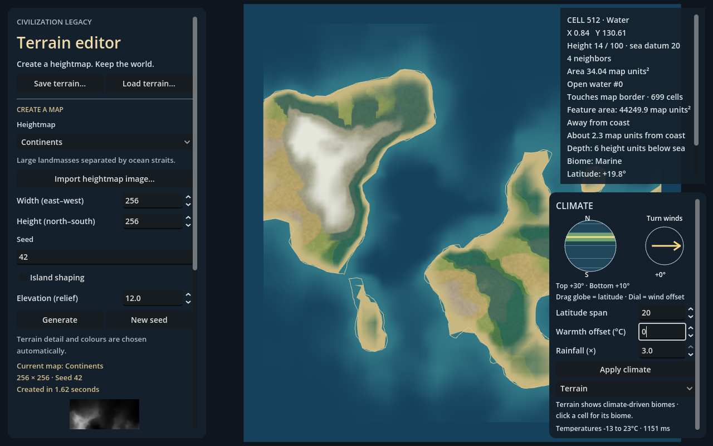

# Civilization Legacy

**A civilization shaped by what previous runs left behind.**

Civilization Legacy is a working title for a 3D miniature grand strategy incremental
built with Godot. The planned game follows successive civilizations: develop a
skill tree, conclude an era through a prestige reset, then build a new civilization
among the advantages, infrastructure and ruins its predecessors left behind.

**Current prototype: a runnable terrain, climate and biome map editor.** Civilization
simulation, provinces, skill trees and prestige are planned gameplay systems.



## What works today

- Seeded 3D heightmaps: 14 procedural templates, noise, supplied world/regional
  heightmaps, and custom image import.
- Independent map width and height, optional island shaping and adjustable relief.
- Connected islands, large landmasses, open water, inland-water candidates and
  depth-tested coastline ribbons with controlled width, cell inspection and
  ocean-depth colours.
- Drainage basins, lake spill levels and outlets, and rainfall-fed rivers that
  collect upstream runoff and widen downstream.
- Basic annual temperature, wind and rainfall generation, including mountain
  cooling and rain shadows.
- A bottom-right climate globe and wind dial, with latitude, warmth and rainfall
  controls plus temperature, rainfall and wind overlays.
- Climate-driven biome ground colours: deserts, steppe, grassland, savanna,
  forests, tundra and ice-covered land, with gently blended boundaries.
- Seven original tiled ground materials, fine normals, wet-ground roughness and
  seeded regional colour, fading into a clean overview.
- Deterministic biome-driven trees, clustered forests and clearings, with five
  original model families, chunked rendering and automatic detail/fading.
- Three prebuilt terrain detail levels per chunk, deep zoom, pan, orbit and tilt.
- An overhead, north-up map at full zoom-out, transitioning to shaded 3D up close.
- Portable terrain save/load, embedded imported heightmaps, overwrite backups
  and grayscale PNG export.

## Open and run

1. Clone this repository or download its source.
2. Install **Godot 4.7.x**. The project is verified with **4.7.2 stable** using the
   **Compatibility** renderer; it does not require C#/.NET or third-party plugins.
3. Import the repository's `project.godot` in Godot Project Manager.
4. Open the project and press **F5**.

With your Godot executable available as `godot`:

```text
godot --editor --path .
godot --path .
```

Godot rebuilds its `.godot/` import cache on the first opening. That generated
cache and local test outputs are excluded from version control.

## Create a map

Choose **Heightmap**, **Seed**, **Width** and **Height**, then press **Generate**.
Optional **Island shaping** lowers the edges toward the sea; **Elevation (relief)**
makes terrain taller or flatter. Detail, noise tuning and other rendering choices
are automatic.

Start at **1024 × 1024**, or try **4096 × 2048** for a larger strategy map. Larger
maps take longer to generate. Geographic density is capped at approximately
100,000 cells; zooming reuses fixed geometry rather than generating new geography.

**Import heightmap image…** stages a PNG, EXR, JPEG or WebP for the next Generate.
Bright pixels represent high ground. Generation changes replace the visible map,
so save a world you like before generating another one.

### Camera

| Control | Action |
| --- | --- |
| Mouse wheel | Zoom toward the cursor |
| WASD / arrow keys / middle-drag | Pan |
| Right-drag after zooming in | Orbit and tilt |
| F | Recenter and return to the full-map view |
| Left-click terrain | Inspect the cell, geographic feature, climate and biome |

The sidebar exposes **Minimum zoom**, **Maximum zoom** and **Closest view size**.
The first two set outward/inward magnification limits; lowering Closest view size
allows a smaller patch of ground to fill the view. A readout explains which limit
is active, and **Farthest view / Closest view** buttons let you try both endpoints.
These are session viewing preferences, not saved map data.

### Climate and biomes

Use the **bottom-right globe** to move the map toward the equator or poles.
Reduce **Latitude span** for a regional map, and drag the compass to rotate winds.
Adjust **Warmth offset** and **Rainfall**, then press **Apply climate**.

Warmth is an adjustment of up to ±20°C, not a 20°C cap on actual temperatures.
The panel shows the calculated temperature range. Select **Terrain** to see the
resulting biome ground cover, lakes and rivers, or choose a climate overlay to
inspect its inputs. **Drainage basins** shows where water collects and exits.
**Show heights** temporarily overrides these colours with grayscale.

Climate edits preserve terrain geometry and coastlines. The model is a simplified
annual estimate rather than daily weather. Hydrology derives runoff separately;
biome colours, labels and seeded miniature tree models are implemented. Seasons
and dynamic ecosystem growth remain future work.

## Development roadmap

| Stage | Current state | Remaining work |
| --- | --- | --- |
| **1. Land and water** | Implemented | Wider edge-case and large-map validation |
| **2. Basic climate** | Implemented prototype | Rainfall, wind and temperature calibration across map types |
| **3. Lakes and rivers** | First pass implemented | Partial/seasonal lake levels, channel erosion and presentation tuning |
| **4. Biomes** | Climate and water-driven habitats, wetlands, riparian woodland and canopy suitability implemented | Detailed vegetation art, seasonal ecology and tuning |
| **5. Ice and presentation** | Partial | Ocean-depth colours, beaches and temperature-based land snow tint exist; frozen water, snowpack and seasonal vegetation remain |

Reservoir candidates now have geometric spill levels, rainfall-fed inflow and
open/closed outlet states. Lake surfaces use spill-capacity levels; underfed lakes
do not yet shrink to equilibrium shorelines. Provinces, political borders, settlements, economy, skill trees,
prestige, terrain painting and complete campaign saves are not implemented.

See the [terrain roadmap](docs/TERRAIN_GENERATION_ROADMAP.md) and
[game design direction](docs/GAME_DESIGN.md).

## Save format

**Save terrain…** writes version **8** `*.terrain.json` documents containing the
source graph, exact saved surface samples, imported image data, terrain settings,
geographic metadata, applied climate parameters and hydrology/biome algorithm versions. Derived geography, climate
biome cover and hydrology are rebuilt from saved source data. Versions **1–7** remain loadable.
Older graphless surfaces need Generate before cell climate can be derived.

Overwriting preserves a `.bak`; documents are bounded to 64 MiB. Pending map or
climate edits are not saved until applied. **Export grayscale PNG…** saves a height
image, not the complete editable map. No distribution builds are configured yet.

## Guides and technical notes

- [Map editor guide](docs/MAP_EDITOR_GUIDE.md)
- [Heightmap implementation](docs/HEIGHTMAP_REFERENCE.md)
- [Land, water and coastline generation](docs/GEOGRAPHY_REFERENCE.md)
- [Coastline ribbon rendering and checks](docs/COASTLINE_RENDERING.md)
- [Miniature vegetation, placement rules and checks](docs/VEGETATION.md)
- [Climate gizmo and model limits](docs/CLIMATE_REFERENCE.md)
- [Biome rules and presentation](docs/BIOMES_REFERENCE.md)
- [Lakes, rivers and drainage](docs/HYDROLOGY_REFERENCE.md)

See [layered terrain materials](docs/TERRAIN_MATERIALS.md) for the new surface library,
zoom behaviour and graphics verification.

## Source layout

```text
project.godot        Godot project entry point
scenes/             Main terrain-editor scene
scripts/domain/     Heightmaps, geographic graphs, climate, biomes and hydrology
scripts/rendering/  Terrain meshes, fixed LOD, water and shaders
scripts/ui/         Runtime editor, camera and climate gizmo
scripts/storage/    Validated terrain documents and migration
data/               Heightmap recipes and bundled source images
tests/              Runtime, generation and save/load checks
docs/               Guides, model limits and game direction
licenses/           Third-party source and asset notices
```

## Verification

The terrain editor, geographic classification, climate/biomes and fixed-LOD camera
checks have passed on Godot **4.7.2**. GPU captures were inspected for climate-driven
terrain appearance, dry/wet worlds and softened biome boundaries at close zoom.
Earlier checks cover recipe parity, rectangular maps, large graphs, imported
heightmaps, malformed saves and legacy documents. These checks are local; no
GitHub Actions workflow or performance guarantee is implied.

Run relevant checks with Godot on your PATH:

```text
godot --headless --path . --script res://tests/terrain_editor_smoke.gd
godot --headless --path . --script res://tests/terrain_geography_smoke.gd
godot --headless --path . --script res://tests/terrain_hydrology_smoke.gd
godot --headless --path . --script res://tests/terrain_climate_smoke.gd
godot --headless --path . --script res://tests/terrain_biomes_smoke.gd
godot --headless --path . --script res://tests/strategy_zoom_smoke.gd
```

For optional rendered captures, run a visual check without `--headless`:

```text
godot --path . --script res://tests/terrain_climate_smoke.gd
godot --path . --script res://tests/terrain_materials_smoke.gd
godot --path . --script res://tests/terrain_coastline_smoke.gd
godot --path . --script res://tests/terrain_vegetation_smoke.gd
```

Generation currently runs synchronously and can pause the editor on large maps.
The climate and biome models are simplified and need broader tuning. Some immediate
headless editor-shutdown checks have logged native transform errors, while runtime
and GPU verification completed without those errors; see the technical notes.

Stage 4 now uses lakes and rivers to support wetlands and riparian woodland. Choose
**Biomes** in the climate panel and click a cell for potential tree cover and water
availability. Layered materials, coast ribbons and seeded tree placement are now
implemented. Further seasonal and political presentation follows the
[CK2-inspired presentation plan](docs/CK2-map-to-Godot-implementation-manual.md);
[inspected asset evidence](docs/CK2_ASSET_REFERENCE.md) documents the reference files.

## Third-party notices

Required third-party source and image attribution is preserved in
[licenses/HEIGHTMAP_SOURCES.md](licenses/HEIGHTMAP_SOURCES.md),
[Heightmap-MIT.txt](licenses/Heightmap-MIT.txt) and
[Alea-MIT.txt](licenses/Alea-MIT.txt). A project-wide license for the original game
code has not been selected.
