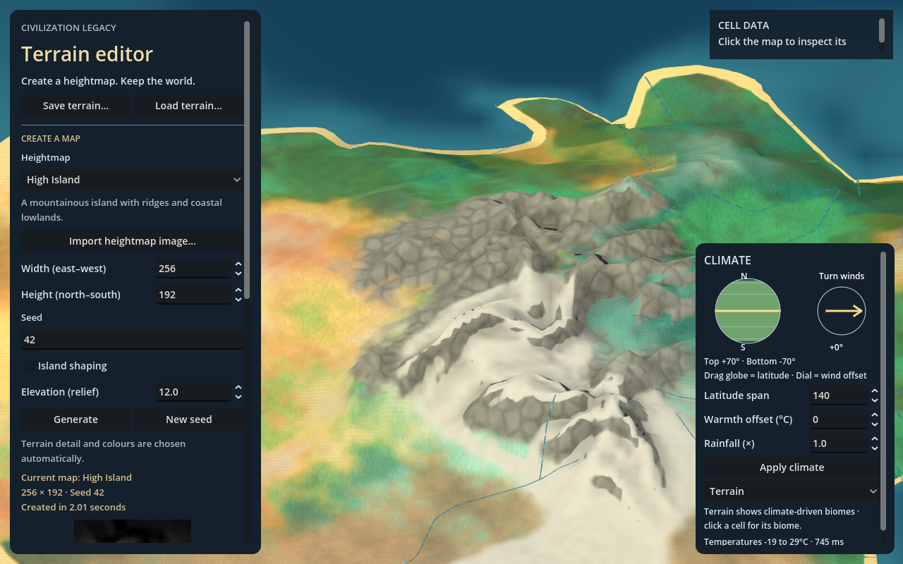

# Mountain terrain

The mountain pass adds original procedural ridge geometry, connected highland
rock, fractured surface detail, exposed steep faces under snow and readable
relief at the flat overview. Biome identity remains climate/hydrology data:
a mountain can still be forest, tundra or desert beneath its presentation layers.

## Installed CK3 reference inspected on 27 October 2026

Read-only shell/Python inspection of readable installed files under
`D:\Program Files (x86)\Steam\steamapps\common\Crusader Kings III\game`:

| File | Observation |
| --- | --- |
| `map_data/heightmap.heightmap` | Declares original size 18432 x 9216, 65-sized tiles, packed/indirection files and five level offsets. |
| `map_data/heightmap.png` | Image header reports 18432 x 9216 and 16-bit integer pixels. Header inspection only; the terrain image was not imported. |
| `map_data/packed_heightmap.png` | Image header reports 3185 x 4061, 16-bit integer pixels. Packing is not reimplemented here. |
| `gfx/FX/pdxterrain.shader:145` | Height-aware material factors are normalized before combining detail surfaces. |
| `gfx/FX/pdxterrain.shader:488` | Detail colour, normals and material properties are calculated separately from terrain normals. |
| `gfx/FX/pdxterrain.shader:511` | Terrain normals are calculated before reorientation with detail normals, snow and lighting. |
| `gfx/FX/pdxterrain.shader:662` | Broad colour is combined with detail colour before material properties and lighting. |
| `gfx/map/terrain/gen_central_mountain_transition_normal.dds` | Header reports a 1024 x 1024 RGBA normal asset; corresponding diffuse/properties assets are present. |

SHA-256 of inspected text files:

- `heightmap.heightmap`: `B1C7DB6CCB095A55B71C1844275D16335E8A62E00AC85BE803AABF97FE3565EF`
- `pdxterrain.shader`: `F9DA79CC484037158B9A87F6F5C6DF90E76F0367CE378C46AE6D4F3CCB8C566B`

These are ordinary source/header observations, not REA Evidence records or
runtime measurements of CK3. No game executable was launched or decompiled.
No CK3 texture, heightmap or shader code is copied into the project. The exact
mountain-authoring process and contribution of each layer to the supplied
screenshots remain unverified. The inference guiding this pass is that detailed
landforms, material normals and lighting must work together; texture tint alone
cannot reproduce the referenced mountain silhouette.

## Original implementation

- `terrain_relief.gd` derives seed-stable, warped ridge spines and branching
  shoulders above normalized source elevation 0.46, reaching full strength at
  0.78. It returns a bounded offset, scaled by the existing elevation and world
  relief scale. Lowlands retain only their previous micro detail.
- `terrain_lod.gd` applies that refinement once before deriving all three LODs.
  Chunks target 192 world units instead of 256, retaining the existing eight-per-
  axis cap and resolution controls. The fixed high-detail normal field is rebuilt
  from the resulting geometry. Alpha contains a restrained local concavity tint.
- Normal texture sampling aligns heightfield nodes with texel centres, avoiding a
  half-texel offset at sharp ridges. High-detail normals also determine exposed
  rock coverage, so it is less dependent on the active mesh LOD.
- Highlands expose connected rock across ridges and steep faces while retaining
  blended foothills. The original rock texture now uses periodic fractured cells
  and ridged noise instead of prominent regular strata stripes.
- Snow remains climate-driven, but steep faces retain more exposed rock. Reduced
  snow albedo leaves lighting headroom instead of flattening bright peaks to white.
- Flat-overview relief uses the same normals and the scene sun direction. Cavity
  tint and hillshading keep mountains legible when overview lighting becomes
  unlit. Climate, biome and height diagnostics still override decorative colour.

The source heightmap, cell heights, biome IDs and runoff graph are not rewritten.
The rendered highland bed is different: this is visual landform refinement, not
physical erosion or a new drainage solution. Detailed channel carving, sediment
transport, authored mountain assets and comprehensive snow/ice remain later work.
Existing saved maps derive the new presentation when loaded; no save schema
change is required. Imported heightmaps also receive the highland refinement.

## Preview and controls

Run the editor, generate **High Island** or another mountainous heightmap, choose
**Terrain**, zoom in and use right-mouse tilt/orbit. **Elevation (relief)** controls
vertical scale. Warm climate exposes more rock; cold climate adds snow. Zoom
fully out to inspect the relief in a flat view. There are no extra runtime knobs.

[Warm rock close-up](images/mountain-rock.png) uses the same map with a +20 C
climate bias for inspection, rather than claiming the default world is that warm.
These captures show the current procedural art, not CK3-quality parity.

## Executed validation

Godot 4.7.2 Compatibility / OpenGL, GTX 1050 Ti:

- `terrain_mountains_smoke.gd`: reproducible/different seeds, integrated highland
  displacement, lowland bounds allowing the existing micro detail, unchanged
  native source/ecology/flow on zoom, and fixed geometry/normal resource identity.
  Graphics captures cover overview, angled range, close, warm rock and biome data.
- `strategy_zoom_smoke.gd`: three fixed subsets, chunk seams, stable normals,
  camera coverage, saved settings and cursor anchoring. The anchor now uses the
  actual displayed surface rather than a source-height point buried by relief.
- `terrain_hydrology_smoke.gd`: drainage and rainfall checks, all 14 procedural
  recipes, lake margins, water picking, dry basins and document round trips.
- `terrain_blending_smoke.gd`: ground/shore/green-margin coverage masks and numeric
  diagnostic preservation.
- `terrain_materials_smoke.gd`: original texture periodicity, normal/roughness
  ranges, shared resources, material brightness and diagnostic bypass.

One headless 1024-square LOD check reported 36 chunks and about 3.7 seconds of
prebuilding; a concurrent graphics 256 x 192 mountain fixture reported about
0.4-0.7 seconds for its 257-square relief field. These are local diagnostic
samples, not isolated benchmarks, frame-rate guarantees or cross-renderer results.
