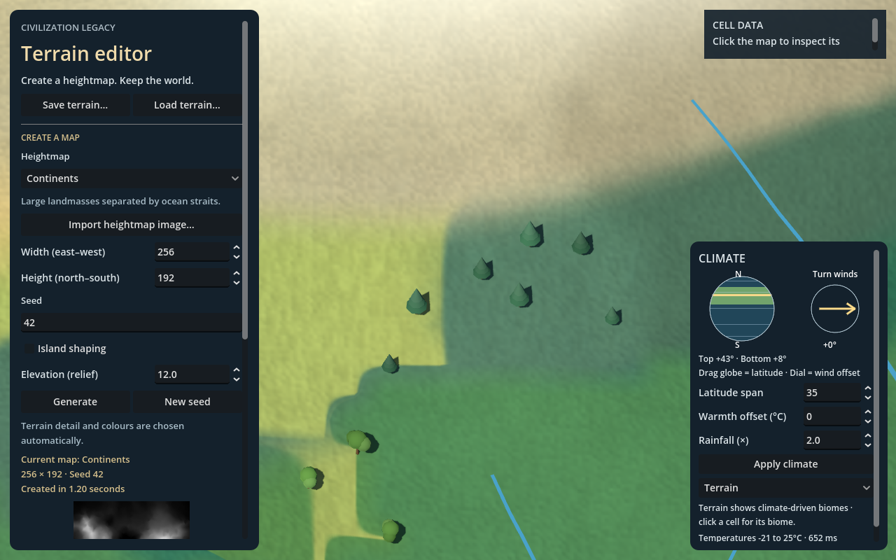

# Deterministic miniature vegetation

Terrain view now places original 3D tree models using native biome/canopy facts,
active water and the displayed height fields. The five starter types are broadleaf,
conifer, dry woodland, tropical and wetland woodland. They are miniature stylized
meshes, not copied game assets or final detailed botanical art.

## Using it

Run or load a map, keep the bottom-right mode on **Terrain**, then zoom into a
forested or wet region. Tree size, rotation, tint and clustering vary automatically.
The cell inspector distinguishes **potential tree cover** from the number of
**placed trees in this cell**. Applying climate rebuilds vegetation from the new
habitat/water facts. No extra generation controls are required.

The flat overview hides individual trees while existing ground colour retains
forest identity. At intermediate zoom, simplified tree meshes and screen-door
fading reduce detail. Close trees use their fuller geometry and shadows. All
climate/biome diagnostics and Show heights hide trees so data remains readable.



## Placement ownership and bounds

`terrain_vegetation_layout.gd` owns presentation placement; `terrain_biomes.gd`
continues to own ecosystem identity and potential canopy. Each native cell gets
an independent Alea stream keyed by map seed and cell identity. Candidate points
are sampled uniformly from its polygon's triangle fan, with area-weighted counts.
Candidate random draws do not depend on camera position. Spatial noise makes
clusters and clearings rather than filling every forest cell uniformly.

Candidate spacing is at least 2 world units and increases with total map area to
target 100,000 candidate slots across the whole map. Per-cell attempts are capped
at 64. Accepted instances are capped at 60,000; if needed, a seeded random priority
selects a subset instead of stopping at the first map rows. A 0.6-world-unit root
separation avoids coincident trunks. These are fixed presentation budgets, so very
large maps become a sparser representation rather than claiming one model per tree.

Accepted trees require positive canopy, non-ocean/non-channel cells and no active
lake membership. Candidate footprints must remain above sea/nearby active lake
levels; roots are checked against all three terrain LOD heights. Additional fine
height samples reject displayed slopes steeper than a 0.85 rise/run. This means
the visual Elevation setting can change placement suitability on exaggerated
cliffs, while the underlying biome identity remains unchanged.

The hydrology view owns its actual rounded river centerlines and widths. It now
indexes those corridors in spatial buckets; the vegetation pass queries that
index with each crown's clearance instead of reconstructing river geometry from
native-cell labels. Rebuilding water clears the index. This is a presentation
clearance API, not a new drainage or gameplay adjacency model.

`terrain_vegetation_view.gd` groups transforms by spatial chunk and tree type in
MultiMesh instances. Chunks are at least 64 world units wide and limited to 16
along the map's longest axis. The model library has two prebuilt meshes per type.
Projected tree size chooses simplified/full geometry with hysteresis; trees fade
between 1.5 and 3.5 pixels per world unit and only enable shadows close up. Each
chunk has expanded bounds for its crowns and height shifts.

The LOD owner retains and binds its existing coarse/middle/fine CPU and GPU height
fields. Tree roots shift to the current terrain height blend in the vertex shader;
instance transforms are not respawned on camera movement. Root position/scale
come from the full instance transform, not reduced-precision custom colour
channels in Compatibility. Packed per-instance colour is used only for tint. Coast ribbons and trees
share one shader height-sampling include, matching the terrain triangle diagonal.

## Saves, limitations and next work

Version 8 saves remain supported unchanged. Positions are deterministic derived
presentation, regenerated from saved source, seed and climate rather than stored
as a second large cache. Hand-painted tree exclusions, roads, reserved settlement
footprints, harvesting, growth, fire and seasonal leaf/snow changes are not yet
implemented. There is no claim that the displayed model count equals ecological
population or canopy percentage.

Lake exclusion is conservative near active lake neighbors. Stem placement and
crown clearances use fixed sampled fields; extreme sub-grid terrain and future
channel carving may need finer checks. The tiny ground inset and height-following
shader reduce floating roots, but this is not a root/terrain intersection model.
Warm/cold biome labels choose coarse tree families rather than individual species.

## Verification

Executed on Godot 4.7.2 Compatibility / OpenGL, GTX 1050 Ti:

```text
godot --path . --script res://tests/terrain_vegetation_smoke.gd
```

The test checks five matching detailed/simple mesh pairs, suitable land, active
lake/channel exclusions, crown clearance from actual rounded river ribbons,
all-LOD sea clearance, complete river-index midpoint coverage, chunking and
population bounds, fixed instance identity on zoom, LOD height bindings, dry-climate
population reduction, unchanged terrain geometry, exact placement after a real
JSON/file round trip, inspector counts and diagnostic/overview visibility. GPU
captures compare the same view with/without trees and verify that tree decoration
does not alter rainfall diagnostic pixels. Base-only terrain is also exercised.
A separate renderer fixture verifies transform-based rooting above height 1300
at X=1023.7 for all three blend values, avoiding reliance on packed custom data.
Captures are written to `.godot/vegetation-*.png`.

The natural 256 by 192 regression scenario produced 56 trees in 6 groups from
495 eligible-cell attempts; its layout stage measured about 13 ms in one local run.
That small case is not a large-map benchmark or a frame-rate guarantee. Trees add
CPU placement, instance memory, draw groups and close-view shadow work.

Design context: [presentation manual, chapter 10](CK2-map-to-Godot-implementation-manual.md).
Godot references: [MultiMesh and instance-data precision](https://docs.godotengine.org/en/4.7/classes/class_multimesh.html),
[spatially grouped MultiMesh rendering](https://docs.godotengine.org/en/4.7/tutorials/performance/using_multimesh.html).

Next planned presentation milestone: snow/season/frozen-water polish, followed by
stable province identity, political colours and border hierarchy when gameplay
map work begins. Vegetation painting and a richer authored asset library can
extend this initial placement layer independently.
